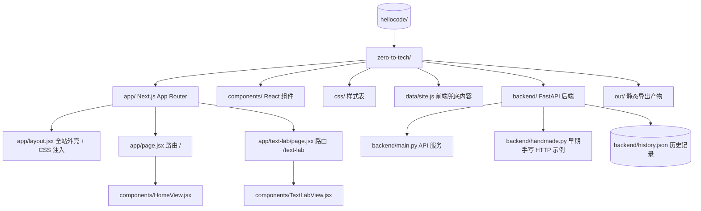
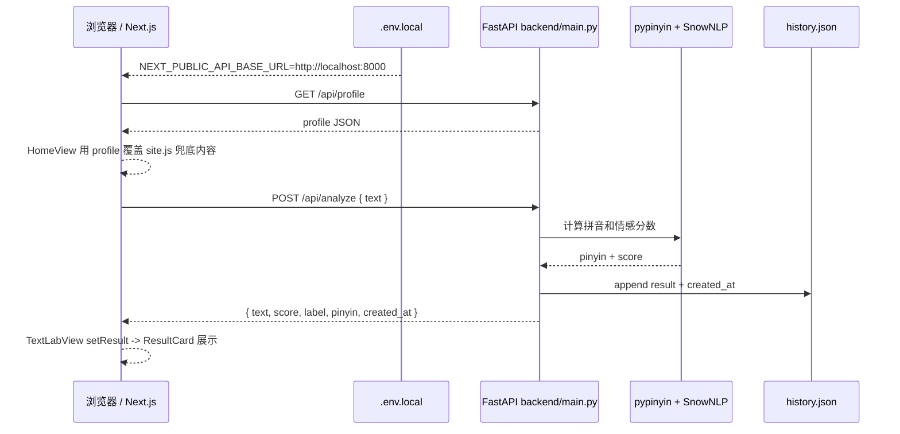

# 项目框架关系图

这个仓库的外层目录很薄，核心项目位于 `zero-to-tech/`。前端是 Next.js App Router，后端是 FastAPI，`data/site.js` 作为前端本地兜底内容，`backend/history.json` 是后端分析记录的本地文件存储。

## 1. 目录与路由总览



## 2. 页面组件关系

```mermaid
flowchart TB
  Layout["app/layout.jsx"] --> Main["<main className=\"page-content\">"]
  Main --> HomePage["/ app/page.jsx"]
  Main --> TextLabPage["/text-lab app/text-lab/page.jsx"]

  HomePage --> HomeView["HomeView.jsx"]
  TextLabPage --> TextLabView["TextLabView.jsx"]

  HomeView --> Nav1["Nav.jsx"]
  HomeView --> Heading["PageHeading.jsx"]
  HomeView --> Grid1["AnimatedCardGrid.jsx"]
  HomeView --> SiteData["data/site.js: home"]

  TextLabView --> Nav2["Nav.jsx"]
  TextLabView --> Heading2["PageHeading.jsx"]
  TextLabView --> Grid2["AnimatedCardGrid.jsx"]
  TextLabView --> InputCard["InputCard.jsx"]
  TextLabView --> ResultCard["ResultCard.jsx"]
  TextLabView --> SiteData2["data/site.js: textLab"]

  TextLabView -. "result state 状态提升" .-> InputCard
  TextLabView -. "result prop" .-> ResultCard
  InputCard -. "onResult(result)" .-> TextLabView
```

## 3. 前后端数据流



## 关键结论

- 路由层由 Next.js App Router 接管：`app/page.jsx` 对应 `/`，`app/text-lab/page.jsx` 对应 `/text-lab`。
- `app/layout.jsx` 是全站外壳，负责 `<html>`、`<body>`、页面容器和全局 CSS 导入。
- `HomeView.jsx` 先使用 `data/site.js` 中的 `home` 作为初始数据，再用 `GET /api/profile` 的结果覆盖展示。
- `TextLabView.jsx` 持有 `result` state：`InputCard.jsx` 发请求并把结果通过 `onResult` 交回父组件，`ResultCard.jsx` 再通过 prop 显示结果。
- `backend/main.py` 是实际 API 入口，提供 `/api/profile`、`/api/analyze`、`/api/history`；`/api/analyze` 会把分析记录追加到 `backend/history.json`。
- `backend/handmade.py` 是更早期的手写 HTTPServer 示例，只提供 `/api/profile`，不是当前主流程。
- `vite.config.js` 仍保留在目录里，但 `package.json` 的脚本只运行 `next dev/build/start`，所以当前主框架是 Next.js，不是 Vite。
